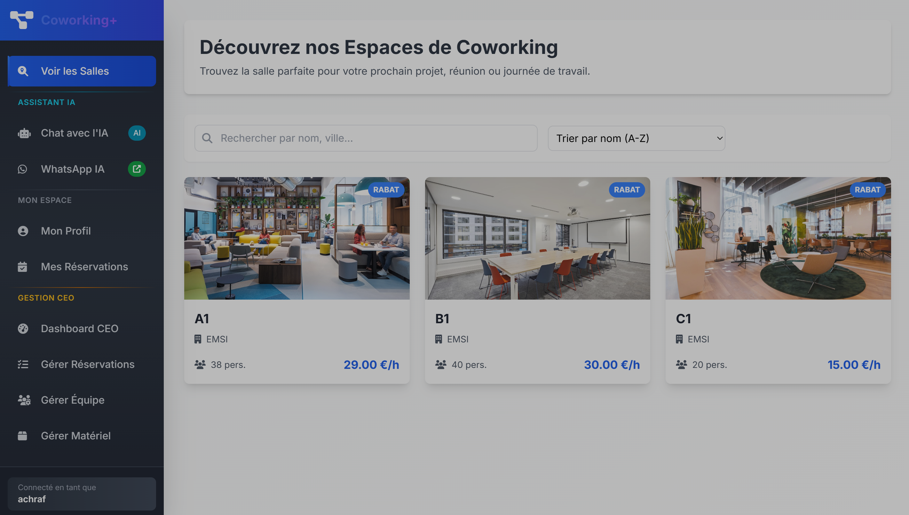
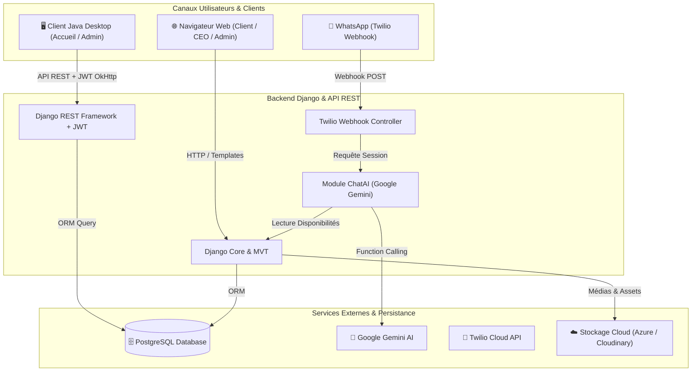

<div align="center">

# 🏢 Smart Coworking Platform & Management Ecosystem

**Plateforme Intelligente et Multi-Plateforme pour la Gestion des Espaces de Coworking**  
*Web Django & DRF • Client Desktop Java (FlatLaf) • Assistant IA (Google Gemini) • Chatbot WhatsApp (Twilio)*

[](https://python.org)
[](https://djangoproject.com)
[](https://www.django-rest-framework.org/)
[](https://www.oracle.com/java/)
[](https://ai.google.dev/)
[](https://www.twilio.com)
[](https://www.postgresql.org/)

---

### 📸 Aperçu Principal de la Plateforme


</div>

---

## 📖 Sommaire
1. [À Propos du Projet](#-à-propos-du-projet)
2. [Points Forts & Innovations](#-points-forts--innovations)
3. [Architecture Globale](#-architecture-globale)
4. [Composants & Fonctionnalités](#-composants--fonctionnalités)
   - [Plateforme Web & Backend (Django)](#1-plateforme-web--backend-django)
   - [Application Desktop de Gestion (Java FlatLaf)](#2-application-desktop-de-gestion-java-flatlaf)
   - [Agent IA Conversationnel & Function Calling (Gemini)](#3-agent-ia-conversationnel--function-calling-gemini)
   - [Intégration WhatsApp (Twilio)](#4-intégration-whatsapp-twilio)
   - [Système Financier & Portefeuille Virtuel](#5-système-financier--portefeuille-virtuel)
   - [Contrôle d'Accès RFID & Sécurité](#6-contrôle-daccès-rfid--sécurité)
5. [Structure du Dépôt](#-structure-du-dépôt)
6. [Installation & Démarrage](#-installation--démarrage)
   - [Prérequis](#prérequis)
   - [Configuration du Backend Django](#configuration-du-backend-django)
   - [Lancement de l'Application Desktop Java](#lancement-de-lapplication-desktop-java)
7. [Documentation des Endpoints API](#-documentation-des-endpoints-api)
8. [Rapport & Documentation Académique](#-rapport--documentation-académique)
9. [Auteurs & Remerciements](#-auteurs--remerciements)

---

## 🌟 À Propos du Projet

Le projet **Smart Coworking Platform** est une solution complète, moderne et interconnectée conçue pour digitaliser et simplifier la gestion quotidienne des espaces de coworking. 

Développé dans le cadre du projet académique de fin d'année (3IIR), il combine :
- Un **backend robuste et un portail Web** en **Django 5** pour les membres, les gestionnaires de salles et les dirigeants d'espaces.
- Une **application cliente lourde Desktop** en **Java 17 / Swing (thème moderne FlatLaf)** dédiée aux administrateurs de site pour la validation, le suivi et le filtrage des réservations en temps réel.
- Une **intelligence artificielle générative (Google Gemini)** connectée aux données de l'application via le *Function Calling*, permettant aux utilisateurs d'interroger les disponibilités, leur solde ou leurs réservations en langage naturel.
- Un **canal conversationnel WhatsApp via Twilio**, offrant un accès direct à l'assistant intelligent sans quitter son application de messagerie.

---

## 🚀 Points Forts & Innovations

- **Architecture Découplée & Hybride** : Communication fluide entre le backend Django et le client lourd Java via une **API REST sécurisée par jetons JWT**.
- **Agent IA Dynamique avec Détection d'Intention (Tool Calling)** : L'assistant virtuel ne se contente pas de répondre à des questions génériques ; il interroge dynamiquement la base de données (salles libres, créneaux, portefeuille client).
- **Omnicanalité (Web & WhatsApp)** : Même logique métier et d'assistance accessible depuis le portail web ou directement sur smartphone via WhatsApp.
- **Portefeuille Virtuel & Système Prépayé** : Gestion du solde des utilisateurs avec recharge instantanée via des coupons/codes à usage unique.
- **Prêt pour l'IoT (RFID Ready)** : Intégration de l'identification matérielle par cartes/badges RFID pour un check-in fluide à l'accueil.
- **UI/UX Moderne** : Interface web intuitive avec thème d'administration personnalisé (`django-jazzmin`) et interface Java enrichie par `FlatLaf`.

---

## 🏗️ Architecture Globale



---

## 📦 Composants & Fonctionnalités

### 1. Plateforme Web & Backend (Django)
- **Gestion Multi-sociétés & Espaces** : Enregistrement de sociétés gérantes, ajout de salles avec caractéristiques détaillées (capacité, horaires, tarif horaire, localisation, photos, équipements).
- **Rôles Utilisateurs Hiérarchisés** :
  - `CEO` : Supervision globale, gestion de sa société et de ses espaces.
  - `Admin` : Gestionnaire d'un espace de coworking spécifique.
  - `User` : Client pouvant explorer, réserver et évaluer les espaces.
- **Cycle de Vie des Réservations** :
  - Statuts gérés : `PENDING`, `CONFIRMED`, `LOCKED`, `COMPLETED`, `CANCELLED`.
  - Calcul dynamique du coût selon la durée et les tarifs de la salle.
  - Système d'évaluation et de notation (1 à 5 étoiles) avec avis clients.

### 2. Application Desktop de Gestion (Java FlatLaf)
- **Interface Client Lourd Moderne** : Conçue en Java 17 avec le look-and-feel sombre/clair moderne `FlatLaf`.
- **Authentification Sécurisée** : Connexion via l'API REST Django avec stockage du JWT Bearer Token.
- **Tableau de Bord des Réservations** :
  - Visualisation en tableau dynamique (`ReservationTableModel`).
  - Filtrage en temps réel par salle et par date avec sélecteur `LGoodDatePicker`.
  - Actions instantanées : Validation de présence (`Complete`) et annulation (`Cancel`).
- **Autonome** : Livrée sous forme de Fat-JAR exécutable avec toutes ses dépendances (`app-1.0-jar-with-dependencies.jar`).

### 3. Agent IA Conversationnel & Function Calling (Gemini)
- Intégration de l'API **Google Generative AI (Gemini)**.
- Fonctions connectées (*Tools*) :
  - `list_salles` : Liste les espaces de coworking actifs.
  - `check_salle_availability` : Vérifie la disponibilité d'une salle pour une date et un créneau horaire donnés.
  - `get_user_reservations` : Consulte les réservations en cours pour l'utilisateur connecté.
  - `get_user_balance` : Donne le solde actuel du portefeuille de l'utilisateur.

### 4. Intégration WhatsApp (Twilio)
- Webhook sécurisé Django recevant les messages WhatsApp entrants.
- Maintien du contexte de session par numéro de téléphone.
- L'IA Gemini traite la requête et renvoie les réponses directement sur WhatsApp avec confirmation en direct.

### 5. Système Financier & Portefeuille Virtuel
- **Solde intégré** à chaque compte utilisateur.
- **Génération et consommation de coupons** (`RechargeSolde`) à code unique pour créditer les comptes.
- Débit automatique lors de la réservation validée.

### 6. Contrôle d'Accès RFID & Sécurité
- Champ `rfid` unique dans le profil utilisateur pour préparer le contrôle physique des portes ou l'enregistrement à l'accueil via badgeuse sans contact.

---

## 📂 Structure du Dépôt

```plaintext
Python_coworking_project/
│
├── main.png                                 # Capture principale de la plateforme
├── README.md                                # Documentation complète du projet
├── app-1.0-jar-with-dependencies.jar        # Exécutable packagé de l'application Desktop Java
├── coworking_project_rapport_*.pdf          # Rapport académique officiel (PDF)
├── coworking_project_rapport_*.docx         # Rapport académique officiel (DOCX)
│
├── coworking_project/                       # PROJET BACKEND & WEB DJANGO
│   ├── manage.py                            # Script d'administration Django
│   ├── requirements.txt                     # Dépendances Python
│   ├── .env.example                         # Modèle de variables d'environnement
│   ├── my_coworking_project/                # Configuration principale Django (settings, urls, wsgi)
│   ├── api/                                 # API RESTful (DRF, JWT, Sérialiseurs)
│   ├── company/                             # Gestion des sociétés, salles, équipements
│   ├── reservations/                        # Gestion des réservations, avis et notes
│   ├── users/                               # Modèle utilisateur personnalisé, rôles, RFID
│   ├── finances/                            # Système de recharge de solde par code
│   ├── chatAI/                              # Assistant IA Gemini avec Tool Calling
│   ├── twilio_chatbot/                      # Webhook WhatsApp Twilio
│   ├── core/                                # Vues et logique commune
│   └── templates/                           # Templates HTML Jinja/Django
│
└── JAVA_Descktop/                           # APPLICATION CLIENT DESKTOP JAVA
    ├── pom.xml                              # Configuration Maven & Dépendances
    └── src/main/java/com/coworking/app/
        ├── MainApp.java                     # Point d'entrée de l'application Desktop
        ├── LoginFrame.java                  # Fenêtre d'authentification JWT
        ├── MainFrame.java                   # Tableau de bord principal de supervision
        ├── ApiService.java                  # Client HTTP OkHttp vers l'API Django
        ├── ReservationTableModel.java       # Modèle de table pour l'affichage
        └── model/                           # Modèles de données (Reservation, Salle, User)
```

---

## ⚙️ Installation & Démarrage

### Prérequis
- **Python** 3.10 ou supérieur
- **Java JDK** 17 ou supérieur
- **Maven** 3.8+ (pour recompiler le client Java si nécessaire)
- **PostgreSQL** (ou base de données compatible)
- Une clé d'API **Google Gemini** (gratuite sur Google AI Studio)

---

### Configuration du Backend Django

1. **Cloner le projet :**
   ```bash
   git clone https://github.com/ACHRAF-KHAIROUNI/Python_coworking_project.git
   cd Python_coworking_project/coworking_project
   ```

2. **Créer et activer un environnement virtuel :**
   ```bash
   # Sous Windows
   python -m venv venv
   .\venv\Scripts\activate

   # Sous Linux / macOS
   python3 -m venv venv
   source venv/bin/activate
   ```

3. **Installer les dépendances :**
   ```bash
   pip install -r requirements.txt
   ```

4. **Configurer les variables d'environnement :**
   Copiez `.env.example` en `.env` et ajustez vos paramètres :
   ```bash
   cp .env.example .env
   ```
   Renseignez notamment votre clé `GOOGLE_API_KEY` et la chaîne de connexion `DATABASE_URL`.

5. **Appliquer les migrations de base de données :**
   ```bash
   python manage.py migrate
   ```

6. **Créer un compte administrateur (Superuser) :**
   ```bash
   python manage.py createsuperuser
   ```

7. **Démarrer le serveur de développement :**
   ```bash
   python manage.py runserver
   ```
   L'application est accessible à l'adresse [http://127.0.0.1:8000/](http://127.0.0.1:8000/).

---

### Lancement de l'Application Desktop Java

#### Option 1 : Lancement direct du JAR précompilé
À la racine du projet :
```bash
java -jar app-1.0-jar-with-dependencies.jar
```

#### Option 2 : Compilation et exécution depuis les sources Maven
```bash
cd JAVA_Descktop
mvn clean package
java -jar target/app-1.0-jar-with-dependencies.jar
```

> **Note :** L'application Java interroge par défaut l'API sur `http://127.0.0.1:8000/api`. Assurez-vous que le serveur Django est en cours d'exécution.

---

## 📡 Documentation des Endpoints API

L'API REST est sécurisée et suit les normes JSON / REST :

| Méthode | Endpoint | Description | Authentification |
| :--- | :--- | :--- | :--- |
| `POST` | `/api/token/` | Obtention de la paire de tokens JWT (`access` & `refresh`) | Publique |
| `POST` | `/api/token/refresh/` | Rafraîchissement d'un token d'accès expiré | Publique |
| `GET` | `/api/reservations/` | Liste filtrable des réservations (`date`, `salle_id`) | Bearer JWT |
| `POST` | `/api/reservations/<id>/complete/` | Marquer une réservation comme terminée (`COMPLETED`) | Bearer JWT |
| `POST` | `/api/reservations/<id>/cancel/` | Annuler une réservation (`CANCELLED`) | Bearer JWT |
| `GET` | `/api/salles/` | Liste des salles de coworking disponibles | Bearer JWT |
| `POST` | `/twilio/webhook/` | Réception des messages WhatsApp via Twilio | Webhook Twilio |

---

## 📄 Rapport & Documentation Académique

Le projet s'accompagne d'un rapport de projet complet détaillant :
- L'analyse des besoins et l'étude d'opportunité.
- La modélisation conceptuelle et les diagrammes UML (Cas d'utilisation, Classes, Séquences).
- L'implémentation logicielle, les défis techniques résolus et les tests de validation.

Les documents sont consultables directement dans ce dépôt :
- 📑 **Format PDF** : `coworking_project_rapport_ACHRAF_KHAIROUNI_IKRAM_ROBAII_3IIR19.pdf`
- 📝 **Format Word** : `coworking_project_rapport_ACHRAF_KHAIROUNI_IKRAM_ROBAII_3IIR19.docx`

---

## 👥 Auteurs & Remerciements

Projet réalisé avec passion par :
- **Achraf KHAIROUNI** ([@ACHRAF-KHAIROUNI](https://github.com/ACHRAF-KHAIROUNI))
- **Ikram ROBAII**

Filière **3IIR** — *Ingénierie Informatique et Réseaux*.

---

<div align="center">
⭐ <i>Si ce projet vous plaît ou vous a été utile, n'hésitez pas à lui attribuer une étoile sur GitHub !</i> ⭐
</div>
